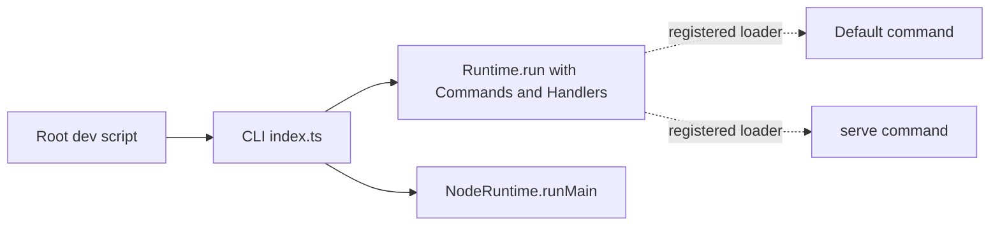

# OpenCode 01 · Identity, package layout and entry points

Inspection date 2026-11-24. OpenCode is maintained under the GitHub owner `anomalyco`, source access is public, and the displayed default branch is `dev`. This investigation uses immutable release `v2.4.1`, commit `6f0514052a3c859894ad01bb14cc14dda1e44b96`. The pinned license is MIT. The moving default branch was inspected for identity and discovery only. [Official docs](https://opencode.ai/docs/) · [Repository](https://github.com/anomalyco/opencode) · [Immutable release](https://github.com/anomalyco/opencode/releases/tag/v2.4.1) · [Commit](https://github.com/anomalyco/opencode/commit/6f0514052a3c859894ad01bb14cc14dda1e44b96) · [License](https://github.com/anomalyco/opencode/blob/6f0514052a3c859894ad01bb14cc14dda1e44b96/LICENSE) · [Inspected license](https://raw.githubusercontent.com/anomalyco/opencode/v2.4.1/LICENSE)

## Verified from source

1. **Workspace layout and development entry points.** The root `package.json` declares Bun 1.4.4 and workspaces under `packages/*`, `packages/plugins/*`, `services/*`, and `packages/data/*`. Its development scripts launch the TypeScript CLI at `packages/cli/src/index.ts` and delegate desktop, web and site development to `packages/desktop`, `packages/app`, and `services/site`. The catalog declares TypeScript, Effect, OpenTUI, Solid and Vite. Turbo runs workspace type checks. CLI and server manifests declare Bun build scripts and package-level Bun tests, while the root test script exits with an instruction to avoid running tests there. The distributed executable's full build path remains open. [Manifest lines 7–42](https://github.com/anomalyco/opencode/blob/6f0514052a3c859894ad01bb14cc14dda1e44b96/package.json#L7-L42) · [Inspected manifest](https://raw.githubusercontent.com/anomalyco/opencode/v2.4.1/package.json) · [CLI manifest](https://github.com/anomalyco/opencode/blob/6f0514052a3c859894ad01bb14cc14dda1e44b96/packages/cli/package.json#L17-L47) · [Server manifest](https://github.com/anomalyco/opencode/blob/6f0514052a3c859894ad01bb14cc14dda1e44b96/packages/server/package.json#L17-L43)
2. **CLI dispatch.** In `packages/cli/src/index.ts`, top-level setup prepares the process and plugin runtime. `Handlers` maps command names to functions returning dynamic imports, including the default command and `serve`. `Runtime.run(Commands, Handlers, ...)` hands control to the command runtime. The outer program uses `NodeRuntime.runMain`, and the fatal reporter writes errors to stderr. A dynamic import returns a promise for a module, so this map can defer loading a handler until the runtime calls its loader. [Entry lines 20–50](https://github.com/anomalyco/opencode/blob/6f0514052a3c859894ad01bb14cc14dda1e44b96/packages/cli/src/index.ts#L20-L50) · [Dispatch and error handling](https://github.com/anomalyco/opencode/blob/6f0514052a3c859894ad01bb14cc14dda1e44b96/packages/cli/src/index.ts#L105-L190) · [Inspected entry](https://raw.githubusercontent.com/anomalyco/opencode/v2.4.1/packages/cli/src/index.ts)
3. **Package boundaries.** The CLI manifest declares workspace dependencies on client, TUI, and server. The server manifest declares core, protocol, and schema dependencies. `workspace:*` resolves to a package in the same repository. The dependency declarations establish allowed import relationships. An actual startup call path through those packages needs separate tracing. [CLI dependencies](https://github.com/anomalyco/opencode/blob/6f0514052a3c859894ad01bb14cc14dda1e44b96/packages/cli/package.json#L28-L47) · [Server dependencies](https://github.com/anomalyco/opencode/blob/6f0514052a3c859894ad01bb14cc14dda1e44b96/packages/server/package.json#L27-L37)

*Verified OpenCode architecture for the development CLI entry and its handler registration. Dashed edges indicate registered loaders.*

## Evidence boundaries

- **Verified from official documentation** — the official introduction describes terminal, desktop and web interfaces. Its product descriptions can evolve separately from the selected revision. [OpenCode documentation](https://opencode.ai/docs/)
- **Engineering inference** — CodeScope can begin with one Python package for repository analysis and a thin CLI entry point. That delivers a testable interface while keeping the first increment small. The package split and runtime choice remain design decisions.
- **Unknown** — default versus service runtime startup, packaged binary startup, UI connection lifecycle, package-specific minimum runtime versions, complete test architecture, and runtime behavior. No upstream program, build, or tests were run.

## Access and verification

The GitHub API branch request was inaccessible in the browser. Cached branch history pointed to a September revision, so the investigation instead used the November immutable release and followed its commit link. Direct SHA raw requests returned cache misses for key files. Source excerpts were read through the immutable release tag, with commit permalinks supplied above. A read-only Git lookup in PowerShell from `D:\CodeScope` used `$env:GIT_TERMINAL_PROMPT='0'; git -c credential.helper= ls-remote https://github.com/anomalyco/opencode.git HEAD refs/heads/dev`. It exited 1 because the configured local proxy connection failed. `ls-remote` requests remote reference hashes without cloning. These checks created no source checkout and installed no dependencies.

## Learning checkpoint and next step

Read the root manifest, the CLI entry file, and both package manifests in that order. Explain how the root script, the application entry point, and the command handler differ. The next proposed read-only increment traces the default command and the `serve` handler at the same release, including configuration loading and the boundary between client startup and server startup.

[Documentation index](../README.md) · [Project state](../../PROJECT_STATE.md)

## Complementary learning notes

- [22 engineering concepts](../04-engineering-concepts/README.md)
- [Reproducible source inspection and package layout](../10-subsystem-learning-notes/01-source-and-package-layout.md)
- [CLI startup and application boundaries](../10-subsystem-learning-notes/02-cli-startup-and-boundaries.md)
