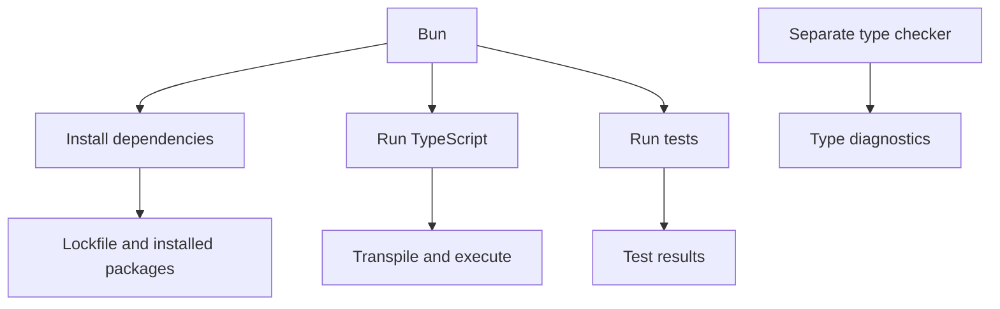

# Bun runtime and package management

OpenCode 01 learning companion · 2026-11-25

## Definition and motivation

Bun combines a JavaScript runtime, package manager, bundler and test runner in one tool. In OpenCode orientation, its relevant roles are starting TypeScript development entry points, resolving workspaces and running package-specific tests.

## Internal mechanism and architectural context

Bun can transpile supported TypeScript syntax as source loads and execute JavaScript. Dependency installation resolves declarations, uses a lockfile and cache, and links installed packages into a usable layout. bun run can launch a named script or run source directly. A separate type check is still needed.

When someone says they ran Bun, ask which operation was involved. Running a script exercises process startup and module resolution. Installing packages exercises dependency resolution and lifecycle behavior. Running tests exercises the test runner. These paths have distinct failure evidence. For instance, an unsupported native add-on can fail at load time even though package resolution succeeded. For reproducibility, keep the declared runtime version and lockfile with any timing comparison, then record the command and whether its dependencies were already in cache.

### Illustrative development workflow



**How to read it.** A source file can execute after transpilation while still failing static type checks. Diagnose installation, execution and typing at their respective steps.

## Related concepts and influencing components

JavaScriptCore, transpilation, package resolution, bun.lock, scripts and runtime compatibility.

## Worked example and measurements

Compare process startup and dependency installation as different operations. Use a separate temperature-controlled build baseline only when measuring performance, and record warm or cold cache state.

**Illustrative example.** This example is teaching material.

```bash
bun run --cwd packages/example src/main.ts # Run source using the package directory.
```

## Trade-offs and failures

Fewer separate tools can simplify setup. Node compatibility, native modules or install hooks may still constrain supported systems. Fast startup or installation depends on the workload and should be measured.

## Verified OpenCode use and CodeScope application

OpenCode pins Bun 1.4.4 and uses it in the development script and package-level tests. CodeScope's Python runtime and uv serve different responsibilities. Bun is currently a reference technology. [Pinned evidence 1](https://github.com/anomalyco/opencode/blob/6f0514052a3c859894ad01bb14cc14dda1e44b96/package.json#L7-L105)

## Official references

- [Primary documentation](https://bun.sh/docs/runtime)
- [OpenCode 01 investigation](../01-reverse-engineering/01-opencode-repository-and-entry-points.md)

## Revision summary

Executing source, installing packages and type-checking are separate jobs.

[Concept index](README.md) · [Next concept](typescript.md)
