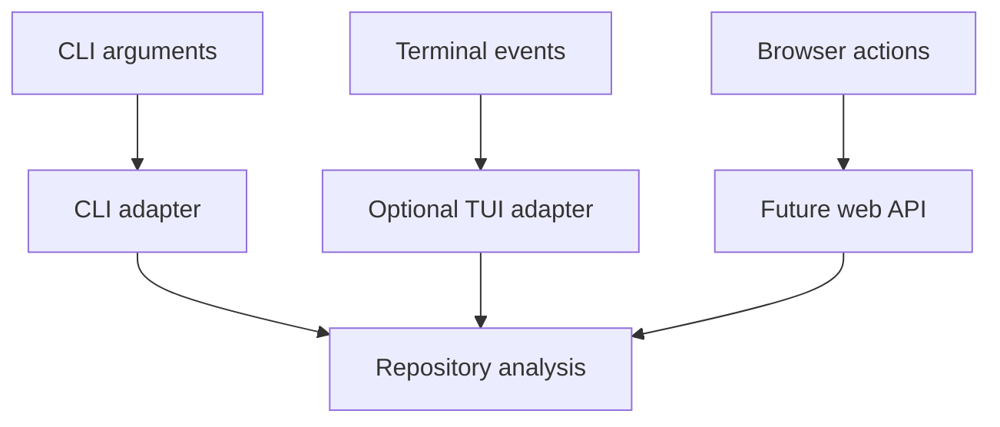

# CLI, TUI and GUI

OpenCode 01 learning companion · 2026-11-25

## Definition and motivation

A CLI takes commands and arguments, commonly writing output and a process status. A TUI renders an interactive interface in a terminal. A GUI uses graphical controls in a browser, desktop application or comparable environment. One product can offer all three.

## Internal mechanism and architectural context

A CLI consumes process arguments and streams. Terminal and graphical interfaces generally maintain interactive event loops, local view state and rendering. Terminal rendering uses character cells and keyboard events. Graphical rendering can use a browser DOM or a desktop toolkit.

For a single workflow, decide what should remain identical across interfaces. A missing path should express the same core failure in all of them. The CLI can express it in stderr and a status code, the TUI in a status line, and the GUI in an accessible inline message. The same repository analysis result can support automation or interactive browsing. Test each presentation separately while reusing the core tests to minimize duplication.

### Proposed CodeScope architecture — interface options



**How to read it.** Input and output differ for each interface. A reusable analysis operation lets the CLI run in-process and gives a future API a clear core boundary.

## Related concepts and influencing components

stdin, stdout, stderr, exit status, terminal events, DOM and accessibility. An interface can call core logic in-process or through an API.

## Worked example and measurements

Expose an index summary as CLI JSON for scripts. A TUI can present keyboard navigation over the same records, while a GUI can display a clickable table.

**Illustrative example.** This example is teaching material.

```bash
codescope inspect ./fixture --format json # Illustrative future invocation.
```

## Trade-offs and failures

CLI output is easy to automate if logs and data are separated. A TUI offers interaction but depends on terminal capabilities. A GUI can make exploration easier while adding state, deployment and accessibility work.

## Verified OpenCode use and CodeScope application

Official OpenCode docs describe terminal, desktop and web interfaces. The root manifest gives separate development launch scripts. CodeScope plans a CLI first and a browser GUI later, subject to design review. [Pinned evidence 1](https://github.com/anomalyco/opencode/blob/6f0514052a3c859894ad01bb14cc14dda1e44b96/package.json#L7-L105)

## Official references

- [Primary documentation](https://opencode.ai/docs/)
- [OpenCode 01 investigation](../01-reverse-engineering/01-opencode-repository-and-entry-points.md)

## Revision summary

Choose the interface based on who consumes it and how they interact with it.

[Concept index](README.md) · [Next concept](command-dispatch.md)
