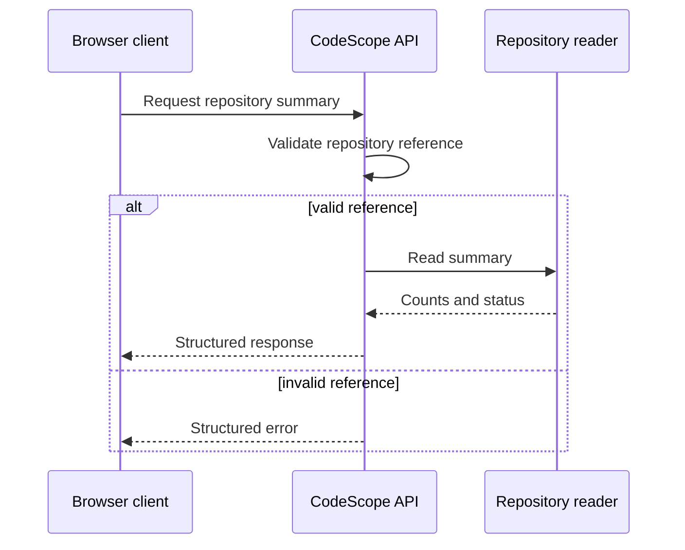

# Client-server architecture

OpenCode 01 learning companion · 2026-11-25

## Definition and motivation

A client initiates a request or opens a stream. A server exposes a contract, validates input and returns results or events. The roles can reside on the same machine or communicate across a network.

## Internal mechanism and architectural context

A client encodes an operation and sends it over a transport. The server decodes it, dispatches a handler and returns a response. Stateful operations can use identifiers and separate status requests or streams. Connection setup, timeouts and authorization depend on the selected contract.

Trace error paths in addition to successful requests. A missing local service, a request that exceeds its deadline and an invalid response schema call for different diagnostics. A read-only query may be retried after a short interruption, while a submitted task may require a request identifier to avoid duplicates. Streaming adds cancellation and buffering considerations. Keeping an early CLI in-process simplifies failures until there is a client that benefits from a stable interface across processes.

### Proposed CodeScope architecture — summary request



**How to read it.** The browser calls the API, while the API owns validation and delegates repository reads. Follow both response paths and identify where a timeout could occur.

## Related concepts and influencing components

Transport, API contract, request lifecycle, process boundary, timeout, idempotency and backpressure.

## Worked example and measurements

For a future CodeScope browser interface, the client can request a repository summary while the server owns path validation and indexing. A missing repository should produce a structured error the client can display.

**Illustrative example.** This example is teaching material.

```text
GET /repositories/example/summary
200 OK
{"files":12,"symbols":40}
```

## Trade-offs and failures

A server contract can serve multiple interfaces. It adds serialization, failure modes and resource costs. Localhost does not establish authorization. Blind retries can duplicate operations with side effects.

## Verified OpenCode use and CodeScope application

OpenCode has client and server package dependencies and official docs describe terminal, desktop and web surfaces. The observed package edges do not establish transport or startup ordering. CodeScope can keep its initial CLI in-process and introduce an API when a second interface needs it. [Pinned evidence 1](https://github.com/anomalyco/opencode/blob/6f0514052a3c859894ad01bb14cc14dda1e44b96/packages/cli/package.json#L28-L47) · [Pinned evidence 2](https://github.com/anomalyco/opencode/blob/6f0514052a3c859894ad01bb14cc14dda1e44b96/packages/server/package.json#L27-L37)

## Official references

- [Primary documentation](https://www.rfc-editor.org/rfc/rfc9110.html)
- [OpenCode 01 investigation](../01-reverse-engineering/01-opencode-repository-and-entry-points.md)

## Revision summary

Client and server are roles defined by the request contract. Establish the process and transport separately.

[Concept index](README.md) · [Next concept](protocols-schemas.md)
