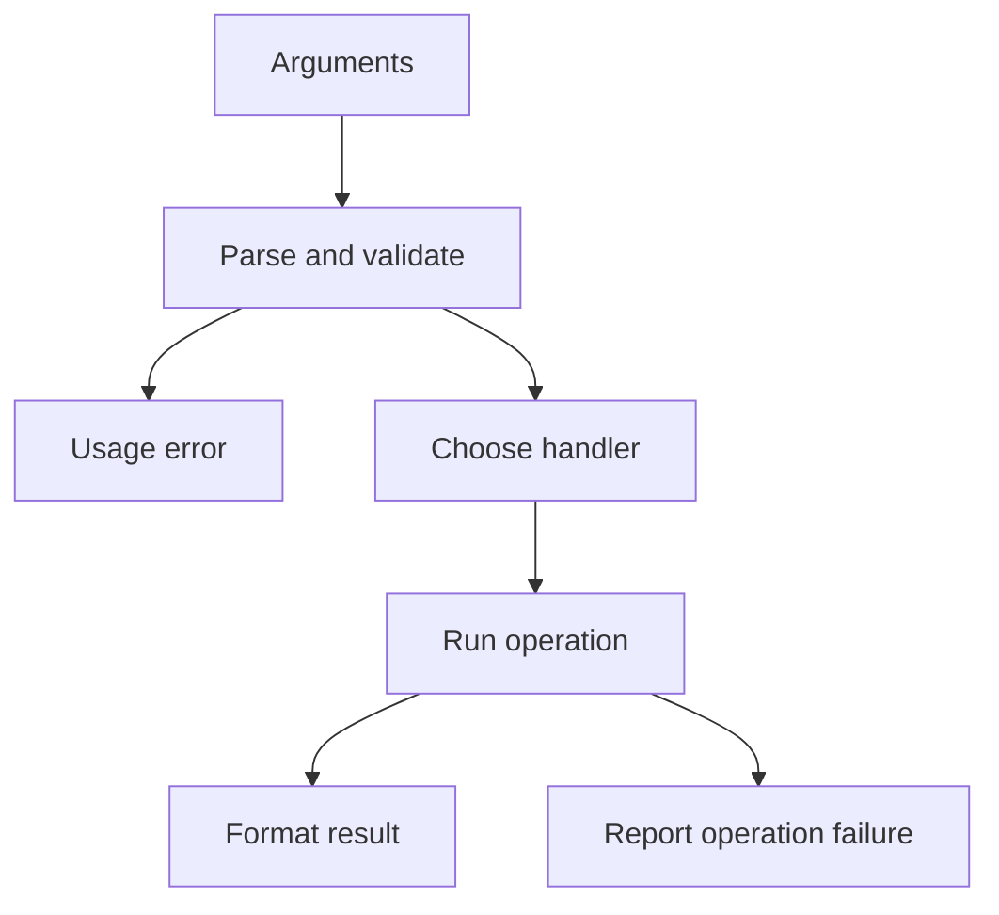

# Command dispatch and command handlers

OpenCode 01 learning companion · 2026-11-25

## Definition and motivation

Dispatch chooses what operation to run from input such as command names and arguments. A handler implements the selected operation. Keeping routing separate from behavior lets multiple commands reuse the same parser and error conventions.

## Internal mechanism and architectural context

A dispatcher can parse argv, match a command specification, validate options and resolve a handler from a registry. It can translate unknown commands or invalid values into a usage error before invoking the handler. A handler returns a result or failure for formatting and exit behavior.

Consider inspect with a required path and a format option. The parser produces structured values, the dispatcher selects inspect, and the handler returns domain data or an error. Parsing failures should be observable before opening the repository. A stable handler contract makes normal execution, validation failures and cancellation testable. Measure command startup separately from handler execution so you can distinguish CLI overhead from the cost of the repository work.

### Proposed CodeScope architecture — CLI dispatch



**How to read it.** Follow invalid input to the usage error. With valid input, handler selection precedes the repository operation. This gives tests separate places to check routing and behavior.

## Related concepts and influencing components

Command registry, argument parsing, routing, input validation and exit status. A loader supplies the handler module and can run after command matching.

## Worked example and measurements

Route inspect to a repository reader and validate the supplied path at the boundary. Call the handler separately in unit tests and test parser wiring through the CLI.

**Illustrative example.** This example is teaching material.

```python
handlers = {'inspect': inspect_repository}
handler = handlers.get(command)  # Select from a fixed set.
if handler is None:
    raise ValueError('Unknown command')
result = handler(path)
```

## Trade-offs and failures

A registry centralizes command selection, but matching bugs and argument defaults can misroute work. Free-form shell invocation adds unnecessary scope. Stable structured errors help CLI users and scripts.

## Verified OpenCode use and CodeScope application

OpenCode declares Commands and a handler map, then calls Runtime.run with both. The exact parser and invocation path remain for a later trace. CodeScope can start with a small explicit command registry or Python's argparse subparsers. [Pinned evidence 1](https://github.com/anomalyco/opencode/blob/6f0514052a3c859894ad01bb14cc14dda1e44b96/packages/cli/src/index.ts#L20-L190)

## Official references

- [Primary documentation](https://docs.python.org/3/library/argparse.html)
- [OpenCode 01 investigation](../01-reverse-engineering/01-opencode-repository-and-entry-points.md)

## Revision summary

Dispatch selects the operation. The handler performs it with validated inputs.

[Concept index](README.md) · [Next concept](imports.md)
