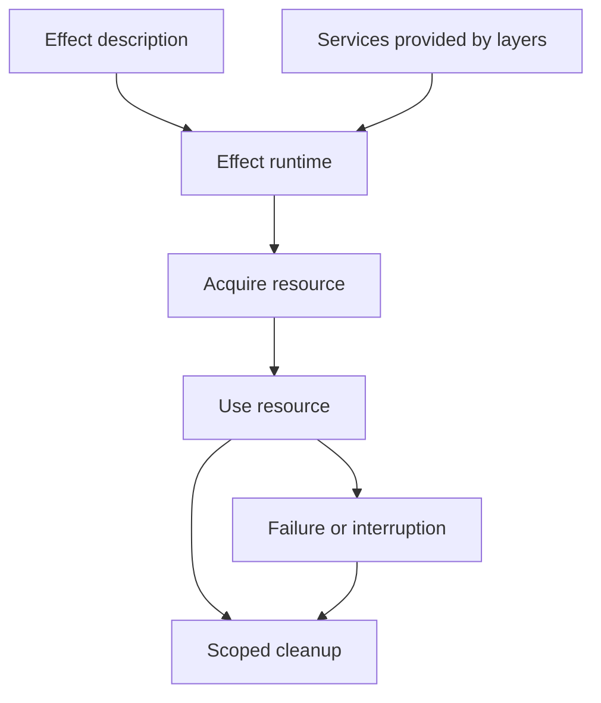

# Effect

OpenCode 01 learning companion · 2026-11-25

## Definition and motivation

Effect is a TypeScript library for composing computations with explicit success, failure and dependency requirements. It helps a program express resource lifetimes, interruption and concurrency with shared semantics across components.

## Internal mechanism and architectural context

An Effect value describes a computation for a runtime to interpret. Effect<A, E, R> describes success A, modeled failure E and required environment R. Layers describe how to construct and supply services. Fibers provide a unit of cooperative concurrency. Interruption and finalizers depend on using appropriate Effect primitives and integration with external operations.

Resource management illustrates why the extra structure can matter. A program may acquire a file or connection, use it during a task, then release it when the scope ends after success, failure or interruption. The effect description composes that lifecycle with its dependency and failure requirements. A plain Promise normally starts work when constructed, while a deferred effect can keep work descriptive until run. Effects wrapped around third-party promises still need the underlying API to support cancellation for real work to stop promptly.

### Illustrative Effect execution architecture



**How to read it.** Follow both outcomes from resource use to cleanup. Scoped primitives tie cleanup to the lifetime managed by the runtime.

## Related concepts and influencing components

Dependency injection, scoped resources, fibers, typed errors and runtime boundaries. Expected errors can be modeled separately from defects.

## Worked example and measurements

Describe a computation that yields a repository summary label. Running the description is the step that delivers the result.

**Illustrative example.** This example is teaching material.

```ts
import { Effect } from 'effect'
const task = Effect.succeed('indexed') // Describe a success value.
await Effect.runPromise(task) // Run this demonstration at the boundary.
```

## Trade-offs and failures

Composability is valuable for lifecycle-heavy applications. Cost includes additional abstraction, type complexity and onboarding. External APIs may need adapters and cancellation support. Reference documentation can describe a different major version.

## Verified OpenCode use and CodeScope application

OpenCode v2.4.1 declares Effect 4.1.0. Its CLI imports Effect and uses NodeRuntime.runMain. CodeScope can apply explicit lifetimes, predictable errors and cancellation in Python without selecting Effect. [Pinned evidence 1](https://github.com/anomalyco/opencode/blob/6f0514052a3c859894ad01bb14cc14dda1e44b96/packages/cli/src/index.ts#L20-L190)

## Official references

- [Effect v4 onboarding](https://effect.website/docs/v4/onboarding)
- [Effect type overview for v3](https://effect.website/docs/getting-started/the-effect-type/)
- [OpenCode 01 investigation](../01-reverse-engineering/01-opencode-repository-and-entry-points.md)

## Revision summary

Separate computation description, service provisioning and execution.

[Concept index](README.md) · [Next concept](opentui.md)
