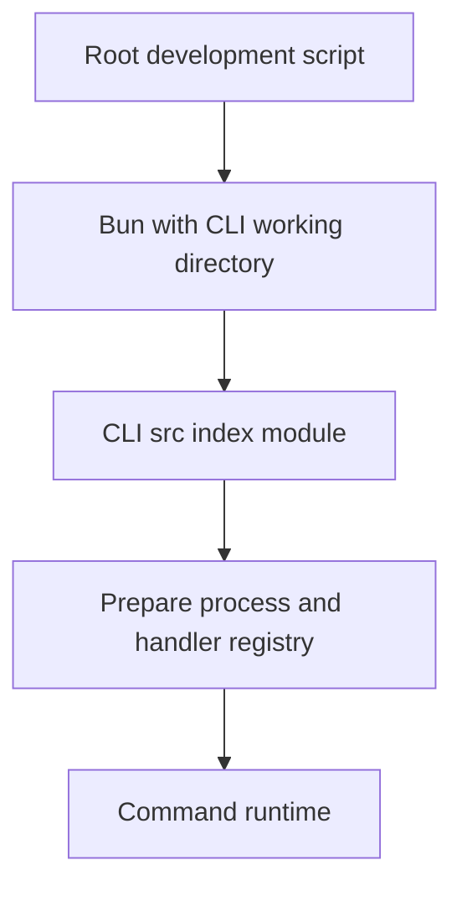

# Application entry points

OpenCode 01 learning companion · 2026-11-25

## Definition and motivation

An entry point is where a specific invocation enters an application. A project can have a source entry for development, a packaged executable entry for users, and separate entries for a browser app or a server.

## Internal mechanism and architectural context

A shell resolves an executable or script. Its runtime loads the designated module and initializes its imports and top-level code. An explicit main function can then parse arguments and compose services. A package manifest can declare public module entry points with a different purpose from the application process entry.

Trace from the actual user command to the operating-system executable, then to the source or packaged entry, then to the first boundary that reads input. A direct run from source and an installed console script can reach similar functionality through different wrappers. A thin composition root makes that difference easy to exercise. It should keep argument parsing, error formatting and dependency construction visible while handing substantive logic to reusable modules. Include a subprocess test later to verify status codes and streams.

### Verified OpenCode architecture — development CLI path



**How to read it.** Start at the development script and follow control into the CLI module. This is the source development path. The distributed executable path needs its own trace.

## Related concepts and influencing components

Bootstrapping, process arguments, shebangs, module exports and composition root. A composition root is where application dependencies are assembled.

## Worked example and measurements

Keep process startup thin so its behavior can be tested without starting a subprocess for every test. A small integration test can still exercise the real command.

**Illustrative example.** This example is teaching material.

```python
def main() -> int:
    return 0  # Return a process status.

if __name__ == '__main__':
    raise SystemExit(main())  # Run only when invoked as a script.
```

## Trade-offs and failures

Top-level I/O adds startup cost and can make imports surprising. Development and installed commands can diverge if packaging metadata points at a different function. Measure startup from process launch to readiness.

## Verified OpenCode use and CodeScope application

OpenCode's dev script names packages/cli/src/index.ts, which constructs handler registrations and runs its program. Installed artifact routing is still open. CodeScope can expose a thin Python CLI entry over reusable repository operations. [Pinned evidence 1](https://github.com/anomalyco/opencode/blob/6f0514052a3c859894ad01bb14cc14dda1e44b96/packages/cli/src/index.ts#L20-L190)

## Official references

- [Primary documentation](https://docs.python.org/3/library/__main__.html)
- [OpenCode 01 investigation](../01-reverse-engineering/01-opencode-repository-and-entry-points.md)

## Revision summary

Identify which invocation you are tracing and find the first application code it executes.

[Concept index](README.md) · [Next concept](cli-tui-gui.md)
