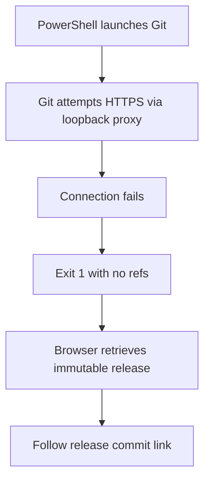

# The Git ls-remote command and observed proxy failure

OpenCode 01 learning companion · 2026-11-25

## Definition and motivation

git ls-remote asks a Git remote for advertised references and object IDs. It is useful for identifying a branch tip without downloading a working tree. The OpenCode 01 lookup was a read-only attempt to resolve HEAD and dev.

## Internal mechanism and architectural context

For HTTPS, Git needs a network route to the remote or configured proxy before it can receive advertised refs. It filters the response by supplied patterns and emits object IDs and ref names. HEAD can be advertised as a symbolic reference, while --symref is needed to request its target in output. The actual command omitted --symref.

The recorded message is a transport-level observation. It shows the attempt used a loopback proxy route and could not connect. It does not reveal whether that proxy was down, unavailable from the process environment, or configured incorrectly. A later diagnostic step would inspect the relevant configuration and approved connectivity without exposing credentials. For a successful run, a ref line contains an object ID and a name. For a query that connects successfully but finds no matching ref, ordinary ls-remote can still exit zero unless --exit-code is requested.

### Observed OpenCode 01 workflow — proxy failure



**How to read it.** The observed Git path ends before reference discovery. The browser fallback supplied independent release and commit evidence. The error leaves the underlying proxy condition unresolved.

## Related concepts and influencing components

GIT_TERMINAL_PROMPT, git -c, credential.helper, proxy, remote refs and process exit status. Disabling prompts and helper lookup changes credential behavior, with network routing configured separately.

## Worked example and measurements

Historical command executed from D:\CodeScope in PowerShell. The assignment exported GIT_TERMINAL_PROMPT=0 to child processes. The semicolon starts the Git command. -c applies an invocation-specific config override. An empty credential.helper resets the helper list. ls-remote selects the operation, the HTTPS URL selects the repository, and HEAD and refs/heads/dev are ref patterns.

**Executed command from OpenCode 01.**

```powershell
$env:GIT_TERMINAL_PROMPT='0'; git -c credential.helper= ls-remote https://github.com/anomalyco/opencode.git HEAD refs/heads/dev
```

## Trade-offs and failures

The observed exit was 1 with `fatal: unable to access 'https://github.com/anomalyco/opencode.git/': Failed to connect to github.com port 443 via 127.0.0.1 after 2126 ms: Could not connect to server`. Git produced no hashes. This supports a connection failure via the proxy, with its underlying cause unverified. The result supplies no evidence about branch existence, credentials or GitHub uptime.

## Verified OpenCode use and CodeScope application

OpenCode 01 used GitHub’s immutable release and followed the commit link after this failed route. CodeScope can classify connectivity separately from authentication and missing refs. Use --exit-code when automation needs a distinct no-match outcome and preserve redacted diagnostics. [Pinned evidence 1](https://github.com/anomalyco/opencode/releases/tag/v2.4.1) · [Pinned evidence 2](https://github.com/anomalyco/opencode/commit/6f0514052a3c859894ad01bb14cc14dda1e44b96)

## Official references

- [Primary documentation](https://git-scm.com/docs/git-ls-remote)
- [OpenCode 01 investigation](../01-reverse-engineering/01-opencode-repository-and-entry-points.md)

## Revision summary

Ref discovery requires connectivity. Capture the actual exit status and use a verified source fallback when possible.

[Concept index](README.md)
