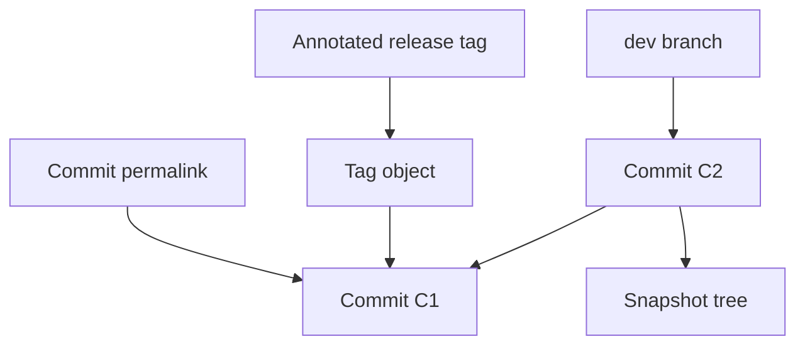

# Git commits, branches, release tags and revision pinning

OpenCode 01 learning companion · 2026-11-25

## Definition and motivation

A commit identifies a snapshot of tracked files and records its parent commits, author and message. A branch is a named reference whose tip can advance as work lands. A tag names a particular Git object, usually a release commit. Pinning chooses an exact object ID so someone reading the research later can retrieve the same files.

## Internal mechanism and architectural context

A commit refers to a tree of paths and blobs. Git derives object IDs from object contents. A lightweight tag is a direct reference. An annotated tag points to a tag object with metadata and can be signed. GitHub release metadata and assets are hosting features associated with a tag. A hosting platform can enforce immutability separately from Git's ref mechanics.

Suppose Alice reads dev before a ref update and Bob reads it afterward. Both can correctly report different code. If both use the same full commit, the source tree agrees even if dev later advances. Record the release name as a human-friendly label and the full commit as the evidence key. Record which paths were inspected and when. For runtime experiments, also capture the interpreter, OS, dependency lockfile, environment and input data. Pinning also has a maintenance cost because fixes made upstream arrive only after a deliberate update and recheck. A tag name alone is insufficient when the host allows tag replacement.

### Git reference and object model



**How to read it.** Follow the branch to C2 and the release tag to C1. The parent edge supports history traversal. A report can keep citing C1 after the branch advances.

## Related concepts and influencing components

HEAD, refs/heads, refs/tags, object identity, detached HEAD and provenance. A detached HEAD arises when checking out a commit directly and can be useful for inspection.

## Worked example and measurements

Pin a release by resolving its tag to a commit, then use that hash in every source permalink. An annotated tag may need peeling to reach the commit.

**Illustrative example.** This example is teaching material.

```bash
git rev-parse 'v2.4.1^{commit}' # Resolve and peel a local tag to a commit.
```

## Trade-offs and failures

A moving branch gives fresh evidence but can make two readers see different code. A pinned source revision improves reproducibility at the cost of ongoing updates. A hash does not capture build dependencies, configuration or runtime behavior. A short hash can become ambiguous as history grows.

## Verified OpenCode use and CodeScope application

OpenCode 01 used GitHub's immutable v2.4.1 release and recorded its full commit. CodeScope can record a fixture commit with every evaluation and separately record lockfile and runtime versions. [Pinned evidence 1](https://github.com/anomalyco/opencode/releases/tag/v2.4.1) · [Pinned evidence 2](https://github.com/anomalyco/opencode/commit/6f0514052a3c859894ad01bb14cc14dda1e44b96)

## Official references

- [Primary documentation](https://git-scm.com/docs/gitrevisions)
- [OpenCode 01 investigation](../01-reverse-engineering/01-opencode-repository-and-entry-points.md)

## Revision summary

A branch follows work. A pinned commit fixes the source under discussion.

[Concept index](README.md) · [Next concept](mit-licensing.md)
