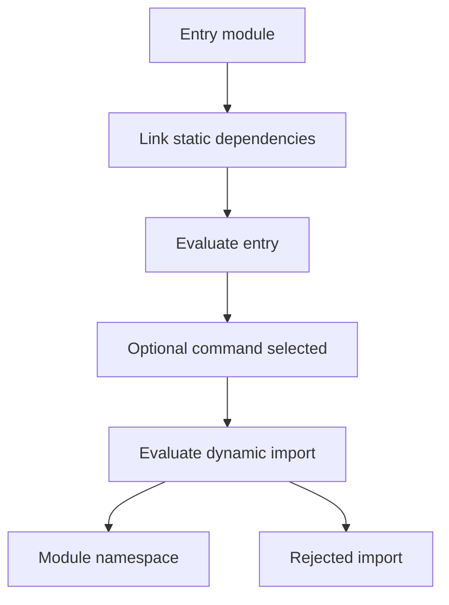

# Static imports and dynamic imports

OpenCode 01 learning companion · 2026-11-25

## Definition and motivation

An import connects a module to code defined elsewhere. JavaScript static imports appear in module declarations and can be analyzed before normal module execution. Dynamic import is an expression that loads a module asynchronously when evaluated.

## Internal mechanism and architectural context

For a static dependency the module loader resolves and links modules before executing their bodies according to module evaluation rules. import() returns a promise for a module namespace or rejects on load or evaluation failure. A bundler can often split known dynamic paths into separate chunks.

Module loading can fail during resolution, linking or evaluation. A malformed specifier and an exception raised by a module's top-level code are both import failures with different causes. The loader may cache an evaluated module within its runtime context, so repeatedly importing it normally does not rerun top-level initialization. Cycles and top-level await can complicate reasoning about initialization order. Keep top-level work minimal and preserve a meaningful error when returning it across a command boundary.

### Illustrative module loading workflow



**How to read it.** The static dependency participates in linking. The dynamic import starts at its expression, so missing optional code can surface only after command selection.

## Related concepts and influencing components

ES modules, module namespace, evaluation order, module caching and code splitting. Type-only TypeScript imports have additional compile-time semantics.

## Worked example and measurements

Keep a tiny help formatter in the initial graph and defer a heavy command module until selected. Test unsupported import paths and rejected loads.

**Illustrative example.** This example is teaching material.

```ts
import { help } from './help'
const loadInspect = () => import('./inspect') // Evaluates import when called.
const { inspect } = await loadInspect()
```

## Trade-offs and failures

Static imports simplify analysis. Dynamic imports can reduce startup work but move failures to first use. Arbitrary module specifiers can complicate bundling and package resolution.

## Verified OpenCode use and CodeScope application

OpenCode statically imports Commands and Runtime and registers dynamically imported handlers. CodeScope can start with ordinary imports and defer optional components after startup measurements justify it. [Pinned evidence 1](https://github.com/anomalyco/opencode/blob/6f0514052a3c859894ad01bb14cc14dda1e44b96/packages/cli/src/index.ts#L20-L190)

## Official references

- [Primary documentation](https://tc39.es/ecma262/multipage/ecmascript-language-expressions.html#sec-import-calls)
- [OpenCode 01 investigation](../01-reverse-engineering/01-opencode-repository-and-entry-points.md)

## Revision summary

A loader function containing import() delays evaluation until the call.

[Concept index](README.md) · [Next concept](lazy-loading.md)
