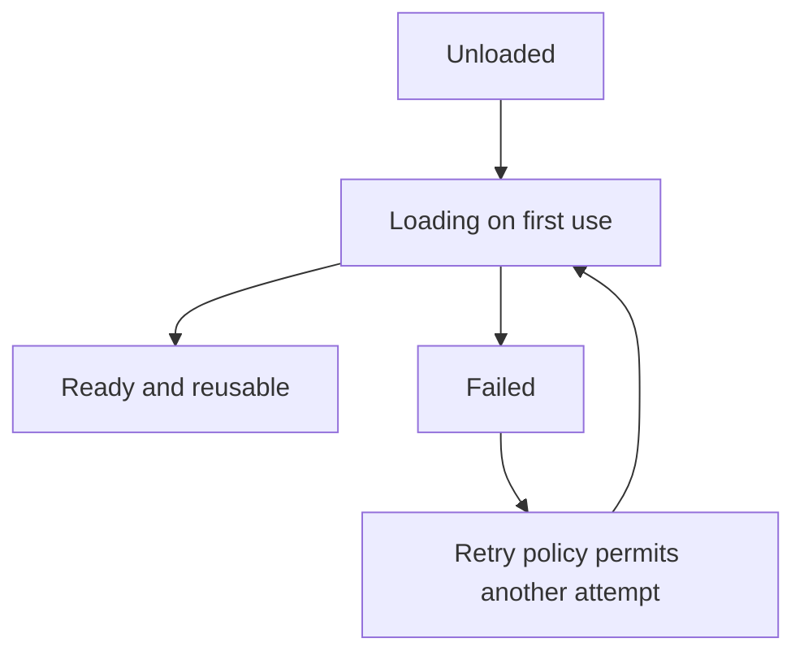

# Lazy loading

OpenCode 01 learning companion · 2026-11-25

## Definition and motivation

Lazy loading defers work until it is needed. It can apply to modules, repository details, database connections, model initialization and other resources. The goal is to avoid paying immediate cost for an optional path.

## Internal mechanism and architectural context

A deferred operation typically begins in an unloaded state, moves through loading, and then becomes ready or failed. A cache can retain a loaded result or in-flight operation to share it across callers. Retry and invalidation policies determine what happens after failure or stale data.

If multiple callers request the first expensive resource simultaneously, reuse a shared in-flight operation if the safety and ownership requirements allow it. Decide whether to cache a failure or permit a later attempt. An initialization timeout can otherwise leave a confusing permanent failure or repeated expensive work. Compare cold start, first-use delay, repeat-use latency and process memory. Deferral is appropriate when a path is optional and its extra latency is acceptable.

### Illustrative initialization states



**How to read it.** Trace the first request and then a repeat request. A caller arriving during Loading may share the in-flight operation. Decide what a retry can safely repeat.

## Related concepts and influencing components

Deferred evaluation, initialization, memoization, first-use latency and resource lifetime. A dynamic import is one way to implement lazy loading.

## Worked example and measurements

Measure both help-command startup and time to first successful indexing call. Compare cold and warm runs because deferred work can simply move latency.

**Illustrative example.** This example is teaching material.

```ts
const loadIndex = () => import('./indexer') // Save a loader.
if (command === 'index') await loadIndex() // Optional work starts here.
```

## Trade-offs and failures

Less initial work may improve readiness and memory use. First-use lag, concurrent first calls and delayed load failures require attention. A resource may remain resident after it is loaded.

## Verified OpenCode use and CodeScope application

OpenCode's handler registration enables deferral through loader functions. Startup and memory effects were not measured. CodeScope can keep model initialization off the path of read-only help and repository-only commands. [Pinned evidence 1](https://github.com/anomalyco/opencode/blob/6f0514052a3c859894ad01bb14cc14dda1e44b96/packages/cli/src/index.ts#L20-L190)

## Official references

- [Primary documentation](https://vite.dev/guide/features)
- [OpenCode 01 investigation](../01-reverse-engineering/01-opencode-repository-and-entry-points.md)

## Revision summary

Lazy loading moves work to first use. Measure startup and first-use latency separately.

[Concept index](README.md) · [Next concept](runtimes.md)
