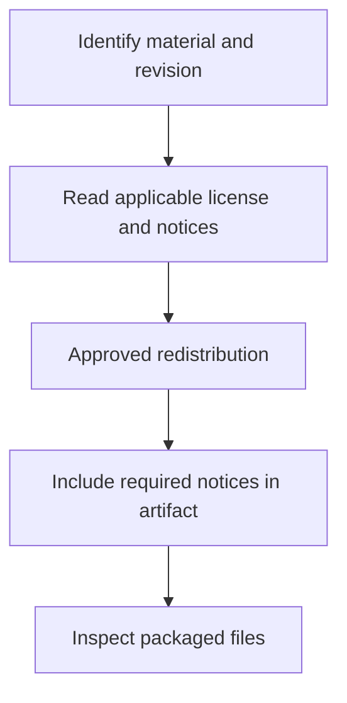

# MIT licensing

OpenCode 01 learning companion · 2026-11-25

## Definition and motivation

The MIT license grants broad permissions to use, modify and redistribute the covered software. It gives downstream users a predictable way to reuse that software with attribution. Its notice condition applies to copies or substantial portions, and the license text disclaims warranty and liability.

## Internal mechanism and architectural context

A license notice supplies permissions and conditions for the material it covers. A repository can include code under other terms through dependencies, vendored assets or separate notices. An independent project can carry its own license while retaining the applicable notices for third-party material it redistributes.

Consider a release archive that carries a third-party parser from an MIT-licensed project. Its package contents need the applicable notice even if the source repository had the notice in another directory. QA can inspect the actual archive and compare the notices to the dependency inventory. Separately, writing an explanation of an upstream design and shipping upstream code are different activities with different evidence needs. Record what was incorporated, its location, and the revision reviewed so a future maintainer can distinguish independent implementation from external material. Investigate conflicting or unclear notices before distributing.

### Illustrative redistribution workflow



**How to read it.** Check the artifact that readers or users actually receive. For a bundled component, compare its license requirements with the notices shipped in that artifact.

## Related concepts and influencing components

Copyright notice, permission notice, dependency license, attribution and distribution artifact. License and version tracking are separate from functionality testing.

## Worked example and measurements

Review the license alongside the pinned source before reuse. Maintain a record of the component, revision, source and accompanying notice so packaging and attribution can be checked together.

**Illustrative example.** This example is teaching material.

```text
component: example-parser
revision: <full upstream commit>
notice: third_party/example-parser/LICENSE
```

## Trade-offs and failures

A short permissive license makes reuse straightforward. Missing notices, mixed-license assets and assuming the root license covers every dependency are common failure modes. OpenCode's license does not establish CodeScope's license.

## Verified OpenCode use and CodeScope application

OpenCode v2.4.1 carries a root MIT license. CodeScope is independently designed. Any future approved reuse should record its provenance and applicable notices. [Pinned evidence 1](https://github.com/anomalyco/opencode/blob/6f0514052a3c859894ad01bb14cc14dda1e44b96/LICENSE)

## Official references

- [Primary documentation](https://opensource.org/license/mit)
- [OpenCode 01 investigation](../01-reverse-engineering/01-opencode-repository-and-entry-points.md)

## Revision summary

Check exactly which material the license covers and preserve required notices with redistribution.

[Concept index](README.md) · [Next concept](monorepo.md)
