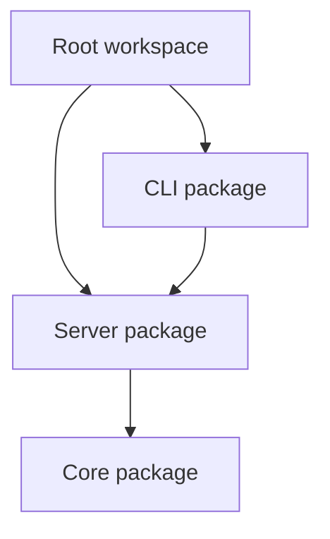

# Monorepo architecture

OpenCode 01 learning companion · 2026-11-25

## Definition and motivation

A monorepo places multiple related packages or projects in one version-controlled repository. It allows a change to an interface, its implementation and callers to land as one reviewable commit.

## Internal mechanism and architectural context

Packages retain their own manifests and tests. Workspace tooling discovers package roots, resolves local dependencies, and lets a task runner build a graph from dependency and task configuration. Folder structure and build tooling are separate decisions from process topology at runtime.

For a concrete dependency change, imagine the shared protocol adds a required field. A local workspace can immediately build and test both its producer and consumer together. Deployments can still happen at different times, so wire compatibility may need more than an atomic commit. Maintain an affected-package test strategy and check package boundaries in CI as the repository grows. A dependency graph should reflect real import relationships. A directory tree only shows containment, so it cannot tell which tests need to run on its own.

### Verified OpenCode architecture — declared package edges



**How to read it.** The root discovers packages. The CLI declares a dependency on the server, which declares a dependency on core. Use the graph to reason about affected packages during development.

## Related concepts and influencing components

Workspace, dependency graph, modular monolith, release cadence, shared configuration and build cache.

## Worked example and measurements

A protocol change could update a message type, a server validator and client tests in one commit. Measure affected-package build time as the project grows.

**Illustrative example.** This example is teaching material.

```text
packages/
  protocol/  # shared contract
  server/    # consumes the contract
  client/    # also consumes the contract
```

## Trade-offs and failures

Atomic changes reduce cross-repository coordination. Broad CI fan-out, circular dependencies and inconsistent package ownership can erase those benefits. A monorepo can contain multiple processes or one deployable application.

## Verified OpenCode use and CodeScope application

OpenCode's root workspace globs cover packages, plugins, services and data packages. CodeScope can start with one Python package and use modules to develop clear interfaces before adding package infrastructure. [Pinned evidence 1](https://github.com/anomalyco/opencode/blob/6f0514052a3c859894ad01bb14cc14dda1e44b96/package.json#L7-L105)

## Official references

- [Primary documentation](https://bun.sh/docs/pm/workspaces)
- [OpenCode 01 investigation](../01-reverse-engineering/01-opencode-repository-and-entry-points.md)

## Revision summary

Repository layout, package boundaries, and deployment topology are three distinct choices.

[Concept index](README.md) · [Next concept](package-json.md)
