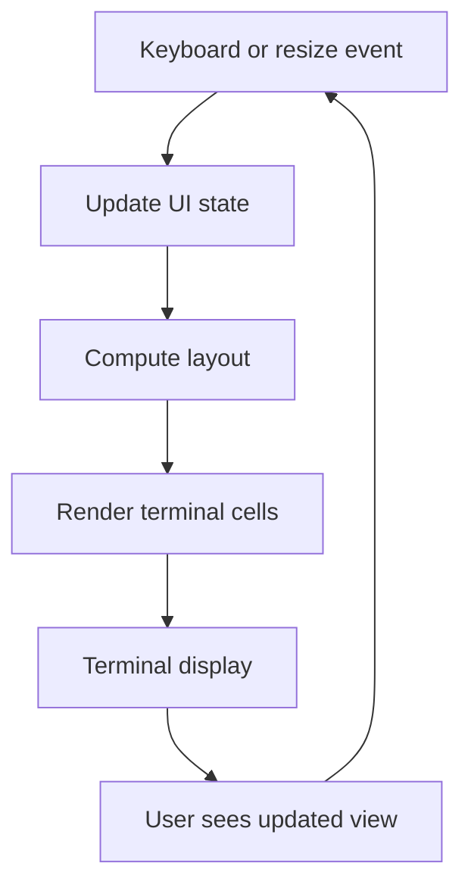

# OpenTUI

OpenCode 01 learning companion · 2026-11-25

## Definition and motivation

OpenTUI is a toolkit for interactive terminal interfaces. It provides rendering and input abstractions for applications that need panes, focus, keyboard navigation and live updates in a terminal.

## Internal mechanism and architectural context

A renderer maps UI elements into a grid of terminal cells. Layout depends on terminal dimensions and display widths. An input loop handles keystrokes and resize events. Terminal UI libraries typically emit control sequences for cursor positioning, color and screen updates and need cleanup to restore terminal modes.

Rendering a details pane requires selection state, available width and a draw policy. Selection can change faster than useful screen refreshes, while output can be slowed by a remote terminal. Batch or throttle updates where appropriate and verify input stays responsive while rendering. Test keyboard-only navigation, pasted input, long paths and output redirection. An emergency exit path is valuable because application-owned changes to terminal state can otherwise make the shell hard to use.

### Illustrative terminal UI event loop



**How to read it.** A resize can change layout while leaving the selected result intact. Follow the cycle to see why input, state and drawing can be tested separately.

## Related concepts and influencing components

Terminal emulator, ANSI escape sequences, renderables, focus, keymaps and reactive bindings.

## Worked example and measurements

A repository browser could update a details pane when selection changes. Test behavior after resize, with wide glyphs and when standard output is redirected.

**Illustrative example.** This example is teaching material.

```text
keypress -> update selection -> layout panes -> render terminal cells
resize   -> recompute layout -> render terminal cells
```

## Trade-offs and failures

A TUI can be usable over a terminal connection and save graphical complexity, but terminals vary in capabilities. Key collisions, width errors and leaked terminal modes can harm usability.

## Verified OpenCode use and CodeScope application

The OpenCode release manifest declares OpenTUI core, keymap and Solid bindings in its catalog. Actual render startup for the default handler is outside OpenCode 01. CodeScope initially needs simple CLI output only. [Pinned evidence 1](https://github.com/anomalyco/opencode/blob/6f0514052a3c859894ad01bb14cc14dda1e44b96/package.json#L7-L105)

## Official references

- [Primary documentation](https://opentui.com/docs/)
- [OpenCode 01 investigation](../01-reverse-engineering/01-opencode-repository-and-entry-points.md)

## Revision summary

A TUI actively manages terminal input and rendering over time.

[Concept index](README.md) · [Next concept](solid.md)
