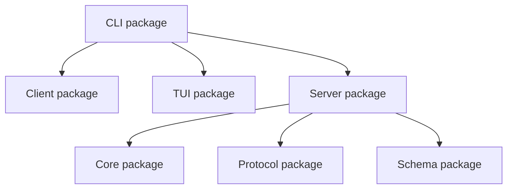

# Package boundaries and separation of concerns

OpenCode 01 learning companion · 2026-11-25

## Definition and motivation

A boundary defines what one component exposes and what it keeps internal. Separation of concerns gives related logic a clear home so dependencies and reasons for change are easier to follow.

## Internal mechanism and architectural context

A package declares dependencies and can expose public APIs through exports. Architectural rules guide which way dependencies should flow. A boundary can be enforced with package configuration, lint rules or dependency tests. Process isolation is a distinct mechanism.

Define boundaries around responsibilities that change at different rates. Presentation can evolve while the repository reader stays stable. A contract that returns domain data makes it possible to stub the reader and test formatting independently. Check dependency cycles and deep imports during review. Declared dependencies provide evidence of intended relationships, while import and call-site inspection are needed to establish actual usage. Isolation and permissions require their own enforcement regardless of package structure.

### Verified OpenCode architecture — manifest dependencies



**How to read it.** Read these arrows as declared dependencies. For a runtime question, look for the corresponding import and call site before drawing a sequence diagram.

## Related concepts and influencing components

Public API, internal implementation, dependency inversion, module, package and process boundary.

## Worked example and measurements

Keep repository parsing independent of CLI presentation. Let the CLI call a reader and format its returned result.

**Illustrative example.** This example is teaching material.

```text
cli -> repository analysis -> file reader
cli -> output formatter
repository analysis depends on no rendering code
```

## Trade-offs and failures

Too few boundaries couple unrelated changes; too many add ceremony. Cycles, deep imports into private modules and shared utility dumping grounds make ownership harder.

## Verified OpenCode use and CodeScope application

OpenCode's manifests establish dependency declarations from CLI toward client/TUI/server and from server toward core/protocol/schema. CodeScope can begin with explicit module boundaries inside one Python package. [Pinned evidence 1](https://github.com/anomalyco/opencode/blob/6f0514052a3c859894ad01bb14cc14dda1e44b96/packages/cli/package.json#L28-L47) · [Pinned evidence 2](https://github.com/anomalyco/opencode/blob/6f0514052a3c859894ad01bb14cc14dda1e44b96/packages/server/package.json#L27-L37)

## Official references

- [Primary documentation](https://nodejs.org/api/packages.html#package-entry-points)
- [OpenCode 01 investigation](../01-reverse-engineering/01-opencode-repository-and-entry-points.md)

## Revision summary

A good boundary makes dependency direction and public contracts easy to explain.

[Concept index](README.md) · [Next concept](client-server.md)
