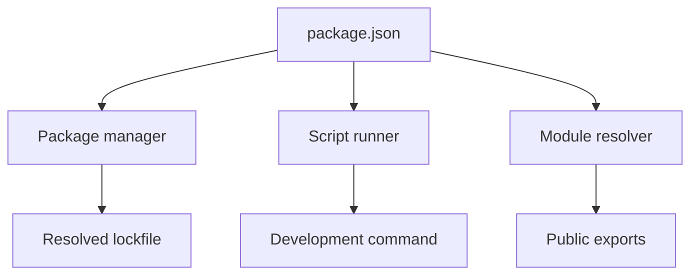

# Package manifests and package.json

OpenCode 01 learning companion · 2026-11-25

## Definition and motivation

A package manifest is machine-readable metadata. In the JavaScript ecosystem package.json can declare identity, dependencies, scripts and public entry points. The manifest states requirements and conventions that tools can read automatically.

## Internal mechanism and architectural context

Installers read dependency ranges and local references to resolve a graph. Lockfiles record concrete resolutions. A runtime or bundler can consult fields such as type and exports when resolving module format and public entry points. Script names are invoked explicitly, except lifecycle scripts recognized by the tooling.

Read a package manifest in two passes. First find its entry metadata and scripts. Then read the dependencies, dev dependencies and workspace links that make those scripts runnable. In a review, ask whether a manifest change also needs a lockfile change and whether install hooks or exports affect users. Type module changes how .js files are interpreted in a package scope. The private field is normally a safeguard against publishing the package accidentally, and says nothing about who can read its repository.

### Illustrative tooling architecture



**How to read it.** Ask which consumer reads each field. The lockfile records a resolution, while scripts and exports influence what tools can launch or import.

## Related concepts and influencing components

Semantic version ranges, exports, lockfiles, lifecycle scripts, dependencies and devDependencies.

## Worked example and measurements

Read scripts first to find development entry points. Inspect the difference between external ranges and local workspace references.

**Illustrative example.** This example is teaching material.

```json
{"name":"example-cli","private":true,"type":"module","scripts":{"dev":"bun src/main.ts"}}
```

## Trade-offs and failures

The file is compact, but a script is executable configuration. Running an unfamiliar install may trigger lifecycle hooks. A dependency declaration establishes availability intent and does not establish a particular runtime call path.

## Verified OpenCode use and CodeScope application

OpenCode's root manifest declares Bun and dev scripts. The CLI manifest records dependencies on other packages. For CodeScope, pyproject.toml will play a related metadata role under Python tooling, with different fields and semantics. [Pinned evidence 1](https://github.com/anomalyco/opencode/blob/6f0514052a3c859894ad01bb14cc14dda1e44b96/package.json#L7-L105)

## Official references

- [Primary documentation](https://docs.npmjs.com/cli/v11/configuring-npm/package-json)
- [OpenCode 01 investigation](../01-reverse-engineering/01-opencode-repository-and-entry-points.md)

## Revision summary

Read the manifest for declared intent, the lockfile for resolution, and the source for behavior.

[Concept index](README.md) · [Next concept](bun.md)
