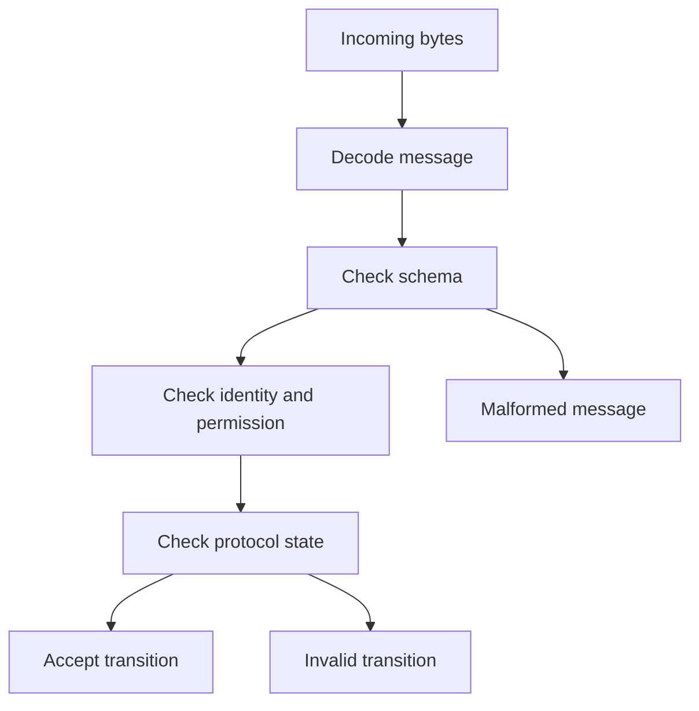

# Protocols and schemas

OpenCode 01 learning companion · 2026-11-25

## Definition and motivation

A protocol specifies how participants communicate, including message order, meaning and error behavior. A schema describes the expected structure of individual messages and can support validation or type generation.

## Internal mechanism and architectural context

Participants serialize data across a boundary and decode it on arrival. A validator checks declared fields and constraints before business logic uses them. The protocol interprets the resulting message in context, such as whether a task identifier exists or a transition is allowed.

Imagine a completion event arrives with every required field but refers to a nonexistent task. It passes shape validation and still fails at the application layer. Record which validations belong to transport decoding, schema checks, authentication and state transitions. Add compatibility fixtures when clients and servers might upgrade independently. A new optional field can be compatible if old readers tolerate unknown fields, while a required field or newly emitted enum variant can break them.

### Illustrative message validation workflow



**How to read it.** A completion message can pass the schema yet fail a protocol check if its task ID is unknown. Each stage answers a different question and can return a distinct error.

## Related concepts and influencing components

Serialization, wire format, compatibility, validation, optional fields, versioning and state transition.

## Worked example and measurements

Define task completion events with a required task ID and state. Check contract behavior for missing fields, unknown states and compatible additions.

**Illustrative example.** This example is teaching material.

```json
{"type":"object","required":["taskId","state"],"properties":{"taskId":{"type":"string"},"state":{"enum":["done","failed"]}}}
```

## Trade-offs and failures

Schemas reduce ambiguity but cannot prove the sender is authorized or the state change is valid. Strictness choices affect forwards compatibility. A breaking requirement can require coordinated client and server releases.

## Verified OpenCode use and CodeScope application

OpenCode's server declares protocol and schema workspace dependencies. OpenCode 01 did not validate a specific message or transport. CodeScope can begin with documented schemas for repository summaries and task events. [Pinned evidence 1](https://github.com/anomalyco/opencode/blob/6f0514052a3c859894ad01bb14cc14dda1e44b96/packages/cli/package.json#L28-L47) · [Pinned evidence 2](https://github.com/anomalyco/opencode/blob/6f0514052a3c859894ad01bb14cc14dda1e44b96/packages/server/package.json#L27-L37)

## Official references

- [Primary documentation](https://json-schema.org/learn/getting-started-step-by-step)
- [OpenCode 01 investigation](../01-reverse-engineering/01-opencode-repository-and-entry-points.md)

## Revision summary

A schema checks shape. A protocol defines what messages mean and when they can occur.

[Concept index](README.md) · [Next concept](git-ls-remote.md)
