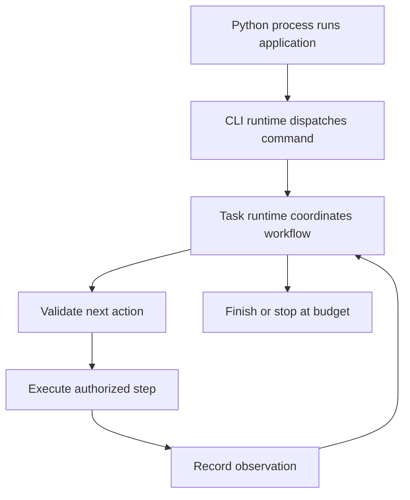

# Language runtimes, command runtimes and agent runtimes

OpenCode 01 learning companion · 2026-11-25

## Definition and motivation

A runtime provides execution services at a particular layer. A language runtime runs code and supports operations such as memory management and I/O. A command runtime coordinates CLI parsing and handler execution. An agent runtime can coordinate task state, tool permissions and bounded model interactions.

## Internal mechanism and architectural context

A language runtime drives execution and asynchronous work. A command runtime interprets a finite command structure and maps inputs to an operation. An agent runtime usually implements a state machine with observations, bounded retries, cancellation and a completion rule. One process can host several of these layers.

Follow a failure through the layers. The task runtime classifies an operation and updates its state. The command runtime may format a user-visible diagnostic. The process runtime ultimately ends with a status and releases resources it owns. Keeping these roles explicit makes cancellation testable. An external operation may need its own deadline even if the command or agent runtime has a larger overall budget. Record terminal states so interrupted execution is distinguishable from a completed task.

### Proposed CodeScope architecture — runtime responsibilities



**How to read it.** The process executes code, the command layer selects behavior, and the task layer owns workflow state. Follow the loop and identify which layer applies a task deadline.

## Related concepts and influencing components

Execution environment, event loop, dispatcher, state machine, deadlines, cancellation and process exit.

## Worked example and measurements

Keep an upper bound on workflow steps even if the model requests more. Model output is input to orchestration and must be validated by the workflow.

**Illustrative example.** This example is teaching material.

```python
for _ in range(step_budget):
    if task_is_complete():
        break
    run_one_authorized_step() # Validate action before execution.
else:
    record_budget_exhausted()
```

## Trade-offs and failures

Layers clarify responsibility but can obscure which component owns deadlines or error conversion. Unbounded loops and missed cancellation lead to resource and reliability failures.

## Verified OpenCode use and CodeScope application

OpenCode's dev script invokes Bun, the CLI calls its command Runtime.run, and the outer Effect program uses NodeRuntime.runMain. OpenCode 01 did not inspect the agent loop. CodeScope can design its task runtime independently and verify it using mocks. [Pinned evidence 1](https://github.com/anomalyco/opencode/blob/6f0514052a3c859894ad01bb14cc14dda1e44b96/packages/cli/src/index.ts#L20-L190)

## Official references

- [Primary documentation](https://bun.sh/docs/runtime)
- [OpenCode 01 investigation](../01-reverse-engineering/01-opencode-repository-and-entry-points.md)

## Revision summary

Ask what each runtime executes and which failures and resources it owns.

[Concept index](README.md) · [Next concept](package-boundaries.md)
