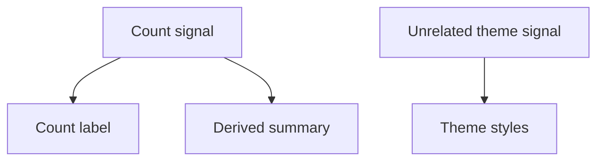

# Solid

OpenCode 01 learning companion · 2026-11-25

## Definition and motivation

Solid is a reactive UI library. It lets developers describe components using JSX and update dependent output when tracked state changes.

## Internal mechanism and architectural context

Signals store values and inform reactive subscribers. During tracked computation, reading a signal registers a dependency. Changing the signal can propagate updates through the affected reactive graph. JSX compilation and the selected renderer determine the target operations, such as DOM updates in a browser.

A derived value is often best computed from existing signals rather than synchronizing a second writable copy. For example, an indexed file count can be computed from scan results. Build side effects for work that reaches outside the reactive graph, such as announcing an update or managing a subscription. Dispose of subscriptions when their owners are removed. Measure the update path where the relevant view is mounted, because a signal's low update cost may be dominated by formatting, DOM writes or terminal rendering.

### Illustrative reactive dependency graph



**How to read it.** Updating the count can notify its dependents. Follow the separate theme edge to see how fine-grained subscriptions limit affected work.

## Related concepts and influencing components

Signal, getter, setter, memo, derived state, effects and cleanup. A JSX syntax choice alone does not determine the renderer.

## Worked example and measurements

Use a signal to track how many files a scan has found. Read it inside a tracked computation so change propagation can observe the dependency.

**Illustrative example.** This example is teaching material.

```tsx
import { createSignal } from 'solid-js'
const [count, setCount] = createSignal(0)
const view = () => <span>{count()} files</span> // Track the read in a render context.
setCount(n => n + 1)
```

## Trade-offs and failures

Fine-grained updates can avoid work, but stale reads can occur when values are extracted outside tracked scopes. Cleanup and ownership matter for subscriptions. The design and runtime cost should be tested with actual update patterns.

## Verified OpenCode use and CodeScope application

OpenCode declares Solid, a Vite Solid plugin and OpenTUI Solid bindings. That verifies declared dependencies rather than any particular browser or terminal component's rendering lifecycle. CodeScope can evaluate a frontend library when the interface needs one. [Pinned evidence 1](https://github.com/anomalyco/opencode/blob/6f0514052a3c859894ad01bb14cc14dda1e44b96/package.json#L7-L105)

## Official references

- [Primary documentation](https://docs.solidjs.com/reference/solid-js/reactivity/create-signal/)
- [OpenCode 01 investigation](../01-reverse-engineering/01-opencode-repository-and-entry-points.md)

## Revision summary

Signals connect state changes to the computations that read them.

[Concept index](README.md) · [Next concept](vite.md)
