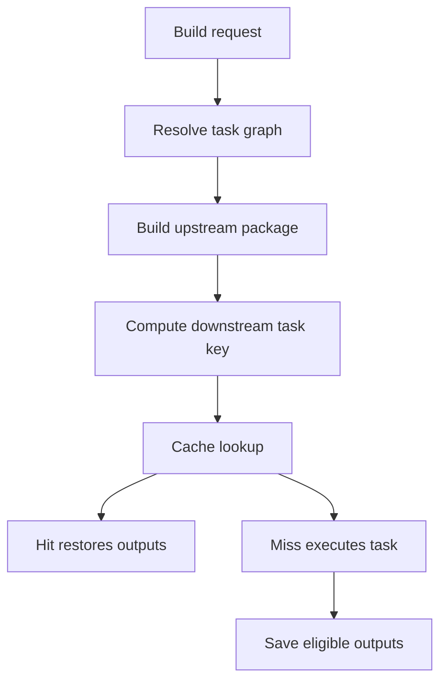

# Turborepo

OpenCode 01 learning companion · 2026-11-25

## Definition and motivation

Turborepo is a task runner for repositories with multiple packages. It uses project relationships and task rules to schedule work and reuse eligible task results.

## Internal mechanism and architectural context

Turbo builds a task graph from package dependencies and configured task edges. A dependency such as ^build can require upstream build tasks first. Cache keys reflect configured and inferred inputs. File outputs need to be declared when downstream consumers need restored artifacts.

Task edges and package edges have different meanings. A package edge says one package depends on another. A task edge says one operation needs another operation's result. For example, type checks may be independent in a repository with ready source declarations, while builds may need upstream emitted files. Inspect cached logs and restored artifacts when diagnosing CI outcomes. Measure wall-clock time and peak memory with multiple concurrency limits so the fastest configuration does not overwhelm a small machine.

### Illustrative task and cache workflow



**How to read it.** The dependency edge establishes task order. The cache key determines whether work can be reused. Include environment inputs and outputs that affect correctness.

## Related concepts and influencing components

Task graph, topological order, cache key, input hashing, cache outputs and concurrency limit.

## Worked example and measurements

Run builds after upstream dependencies and restore build outputs for an identical input state. Compare cache-hit and cache-miss timings independently.

**Illustrative example.** This example is teaching material.

```json
{"tasks":{"build":{"dependsOn":["^build"],"outputs":["dist/**"]}}}
```

## Trade-offs and failures

Caching can save time, but missing input declarations, environmental differences or nondeterministic outputs can yield surprising results. Parallel tasks consume memory, so tighter concurrency may help a small machine.

## Verified OpenCode use and CodeScope application

OpenCode's source manifest runs Turbo type checking with concurrency limited to three. The full pinned Turbo configuration was unavailable during orientation. CodeScope can begin with straightforward test commands while it has one package. [Pinned evidence 1](https://github.com/anomalyco/opencode/blob/6f0514052a3c859894ad01bb14cc14dda1e44b96/package.json#L7-L105)

## Official references

- [Primary documentation](https://turborepo.dev/docs/crafting-your-repository/configuring-tasks)
- [OpenCode 01 investigation](../01-reverse-engineering/01-opencode-repository-and-entry-points.md)

## Revision summary

Turbo schedules tasks and caches eligible work using declared relationships and inputs.

[Concept index](README.md) · [Next concept](workspaces.md)
