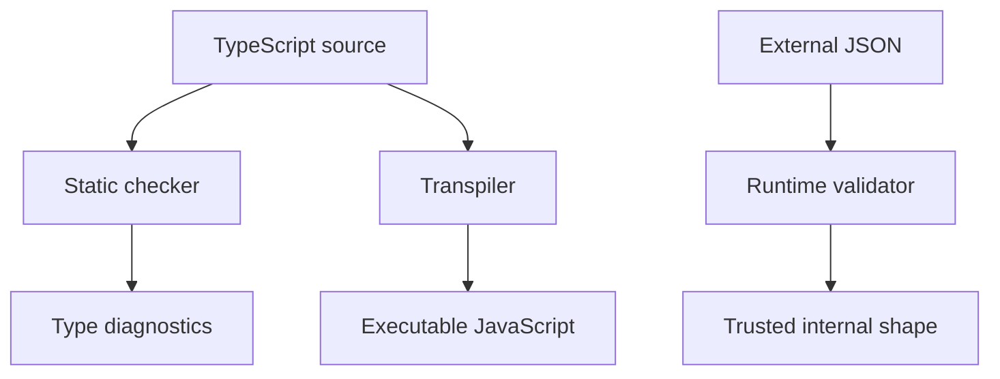

# TypeScript

OpenCode 01 learning companion · 2026-11-25

## Definition and motivation

TypeScript layers static types over JavaScript to express expected values and interfaces across modules. A checker can flag inconsistent callers before execution and help an editor navigate a codebase.

## Internal mechanism and architectural context

The checker compares inferred and declared types using rules such as structural compatibility and control-flow narrowing. Transpilation removes ordinary type annotations and transforms supported syntax into JavaScript. Runtime data needs its own validation because a type annotation cannot constrain bytes received from an API.

Structural compatibility means a value can satisfy a type through the properties it has, even if its author never declared that interface. This is convenient for small fixtures, but can accept accidental matches. Type narrowing uses evidence from a control-flow path and preserves the narrower result only where that evidence applies. At a network boundary, parse data as unknown and validate it before assigning the internal type. Tests should exercise both legitimate variants and malformed external payloads.

### Illustrative type-checking and validation workflow



**How to read it.** The upper paths operate on program source. External data arrives after execution begins, so the runtime validator checks it before the application uses it.

## Related concepts and influencing components

Inference, generics, discriminated unions, structural typing, module resolution and runtime schemas.

## Worked example and measurements

Model a two-state task result using a discriminated union. In a branch where kind is ok the checker can infer that count exists.

**Illustrative example.** This example is teaching material.

```ts
type Result = { kind: 'ok'; count: number } | { kind: 'error'; message: string }
function label(r: Result) {
  return r.kind === 'ok' ? String(r.count) : r.message // Narrow by discriminant.
}
```

## Trade-offs and failures

Types make interfaces clearer, but overly broad any values and unchecked assertions weaken guarantees. A successful transpile does not establish successful type checking or runtime validation.

## Verified OpenCode use and CodeScope application

OpenCode's manifest declares TypeScript and starts a .ts CLI entry point. CodeScope can use Python type annotations on the backend and consider TypeScript for a later browser client. [Pinned evidence 1](https://github.com/anomalyco/opencode/blob/6f0514052a3c859894ad01bb14cc14dda1e44b96/packages/cli/src/index.ts#L20-L190)

## Official references

- [Primary documentation](https://www.typescriptlang.org/docs/handbook/2/narrowing.html)
- [OpenCode 01 investigation](../01-reverse-engineering/01-opencode-repository-and-entry-points.md)

## Revision summary

TypeScript helps check program assumptions before execution. Validate external data at runtime.

[Concept index](README.md) · [Next concept](effect.md)
