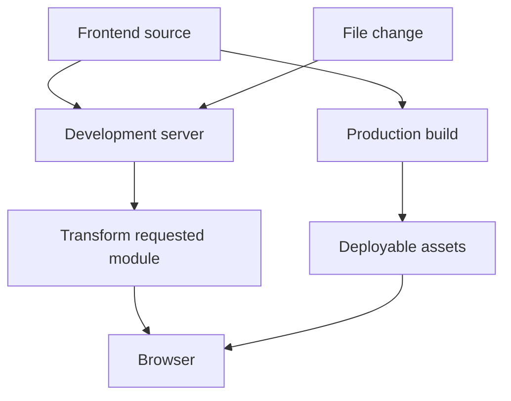

# Vite

OpenCode 01 learning companion · 2026-11-25

## Definition and motivation

Vite supplies frontend development and build tooling. It serves a fast edit-and-preview loop during development and transforms project inputs into deployable output during a build.

## Internal mechanism and architectural context

The development server transforms requested modules and tracks the module graph for hot updates. Hot module replacement can apply a change without reloading the whole document when a boundary supports it. Production build behavior depends on version, plugins and configuration.

A development request might cause Vite to transform a TypeScript module and return executable JavaScript to the browser. When the underlying file changes, the dev server identifies affected modules and sends the update to the client. In production, files are emitted ahead of time and may be served from a different base path. Verify a built artifact with its intended URL prefix and API routing. Review public configuration in the build because a browser user can inspect the files it downloads.

### Illustrative development and build workflows



**How to read it.** The browser receives transformed modules during development. Test the other path too, using the built assets at their intended deployment URL.

## Related concepts and influencing components

Module graph, hot module replacement, dependency optimization, transform plugins, asset base path and production bundle.

## Worked example and measurements

For a browser interface, measure time to first usable view and compare local edits with production output. Treat application API endpoints separately from the development server configuration.

**Illustrative example.** This example is teaching material.

```json
{"scripts":{"dev":"vite","build":"vite build"}}
```

## Trade-offs and failures

Fast feedback helps UI work. Development configuration can hide production routing or path mistakes. Frontend variables exposed to build output cannot safely hold secrets.

## Verified OpenCode use and CodeScope application

OpenCode's root manifest declares Vite and a CLI browser-development script that launches dev/vite.ts. It also delegates web development to packages/app. CodeScope can consider Vite for the later browser phase after specifying the backend contract. [Pinned evidence 1](https://github.com/anomalyco/opencode/blob/6f0514052a3c859894ad01bb14cc14dda1e44b96/package.json#L7-L105)

## Official references

- [Primary documentation](https://vite.dev/guide/features)
- [OpenCode 01 investigation](../01-reverse-engineering/01-opencode-repository-and-entry-points.md)

## Revision summary

A frontend development server and a production bundle solve different problems.

[Concept index](README.md) · [Next concept](turborepo.md)
