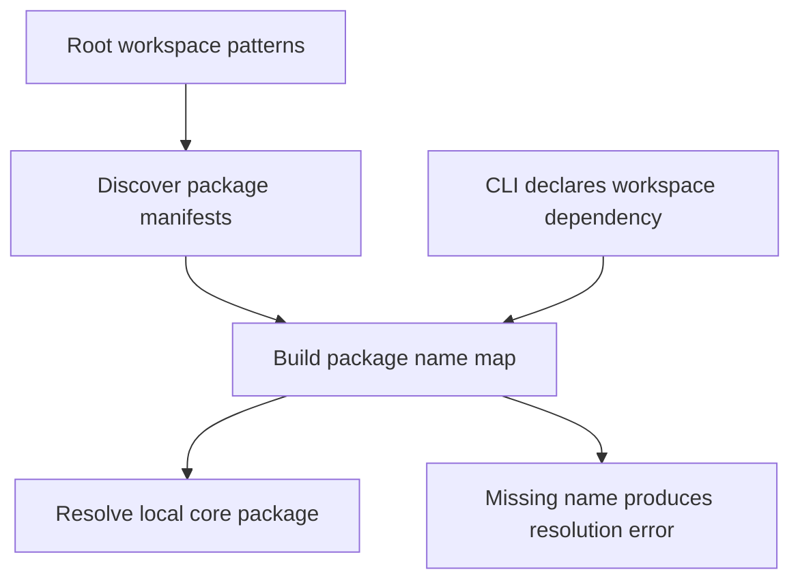

# Workspaces and workspace:* dependencies

OpenCode 01 learning companion · 2026-11-25

## Definition and motivation

A workspace lets a package manager treat multiple package roots together. The workspace protocol expresses that a dependency should come from a package in the same workspace.

## Internal mechanism and architectural context

The package manager discovers manifests through root workspace patterns. Package names identify candidate local dependencies. The installer links the local package and records resolution information. Publishing tools may rewrite workspace ranges for the registry depending on the manager and workflow.

Suppose a test passes because a module happens to exist in a shared installation. If its own package manifest never declares that dependency, packaging or a clean install may expose the mistake. Check public exports as well as dependency declarations. The CLI should import the supported name from the core package rather than relying on internal source paths. Verify graph changes after moving directories because workspace globs govern discovery before any local reference can resolve.

### Illustrative workspace dependency resolution



**How to read it.** The package manager discovers candidates before resolving a local dependency by name. A renamed package can break resolution even if its directory still exists.

## Related concepts and influencing components

Workspace glob, package name, lockfile, local link, published dependency range and catalog. The catalog centralizes selected dependency versions and has a different function from local package linking.

## Worked example and measurements

Create a CLI package that declares a local dependency on a same-workspace core package. Check that the package name matches the core package's manifest.

**Illustrative example.** This example is teaching material.

```json
{"name":"@example/cli","dependencies":{"@example/core":"workspace:*"}}
```

## Trade-offs and failures

Local linking makes cross-package changes easy. Missing workspace patterns, inconsistent package names and exports that work only in a source checkout can break packaged consumers. Hoisting can mask undeclared dependencies.

## Verified OpenCode use and CodeScope application

OpenCode declares its workspace groups at the root. Its CLI and server manifests use workspace:* for dependencies such as server and core. CodeScope can use ordinary Python imports within one package initially. [Pinned evidence 1](https://github.com/anomalyco/opencode/blob/6f0514052a3c859894ad01bb14cc14dda1e44b96/packages/cli/package.json#L28-L47) · [Pinned evidence 2](https://github.com/anomalyco/opencode/blob/6f0514052a3c859894ad01bb14cc14dda1e44b96/packages/server/package.json#L27-L37)

## Official references

- [Primary documentation](https://bun.sh/docs/pm/workspaces)
- [OpenCode 01 investigation](../01-reverse-engineering/01-opencode-repository-and-entry-points.md)

## Revision summary

The root discovers packages. workspace:* declares a dependency on one of those local packages.

[Concept index](README.md) · [Next concept](entry-points.md)
