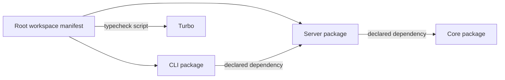

# Reproducible source inspection and package layout

## Learning objectives and prerequisites

Explain how a named release becomes fixed source evidence, distinguish license conditions from project ownership, and read a workspace manifest as a map of package and build relationships. Read concepts 1–12 and 22 as needed. [Concept index](../04-engineering-concepts/README.md)

## Primary references and actual implementation

The immutable release identifies commit `6f0514052a3c859894ad01bb14cc14dda1e44b96`. The root manifest declares package discovery patterns, shared dependency versions, a Bun version and executable scripts. The CLI and server packages own their own scripts and depend on local workspace packages. The MIT notice covers the material released under that license. [Release](https://github.com/anomalyco/opencode/releases/tag/v2.4.1) · [Root manifest](https://github.com/anomalyco/opencode/blob/6f0514052a3c859894ad01bb14cc14dda1e44b96/package.json#L7-L42) · [CLI manifest](https://github.com/anomalyco/opencode/blob/6f0514052a3c859894ad01bb14cc14dda1e44b96/packages/cli/package.json#L17-L47) · [MIT notice](https://github.com/anomalyco/opencode/blob/6f0514052a3c859894ad01bb14cc14dda1e44b96/LICENSE)

**Actual OpenCode manifest excerpt.** The key names the development script. Bun dispatches the script from that manifest. The inner command sets the package working directory before loading its TypeScript entry.

```json
"dev": "bun run --cwd packages/cli src/index.ts",
```

## Execution flow, data and trade-offs



*Verified OpenCode package declarations. An arrow between packages represents a dependency declaration.*

Workspace discovery associates package names with directories. Dependencies form a graph, whereas the file tree represents containment. A build tool can schedule tasks by walking task and package edges. Package changes can land atomically, but deployment concerns and version compatibility still require independent decisions. Smaller projects can begin with a single package and simple test commands. Build performance depends on input hashes, cached artifacts and concurrency. Reading source directly avoids executing install hooks during investigation.

The historical Git lookup failed before receiving remote reference data, so the immutable GitHub release became the verified fallback. A pinned commit lets readers reconstruct source evidence but does not capture the local environment used for a runtime experiment. [Git failure analysis](../04-engineering-concepts/git-ls-remote.md)

## Interview practice

- **Foundational** — Why pin the commit? A stable identifier fixes the source tree used as evidence while branches advance.
- **Applied** — Where would you look for advertised development and test commands? Start with the root scripts, then inspect the matching package manifest.
- **Advanced** — Can a package graph establish deployment ordering? It records software dependencies. Deployment ordering additionally depends on runtime topology and compatibility.

## Exercise, verification and mastery

Starting from the pinned manifest, identify the Bun declaration, one local dependency and one package-level test command. Explain how each was verified, then explain why the proxy failure cannot prove whether a branch exists. The evidence in this note is a source reading. No upstream build or test result was collected. Demonstrate understanding by reproducing the evidence chain in your own words. The tracker advances only with demonstrated evidence.

## Revision summary

Follow release → commit → manifest → package. Track Git evidence, dependency resolution and runtime observations independently.
