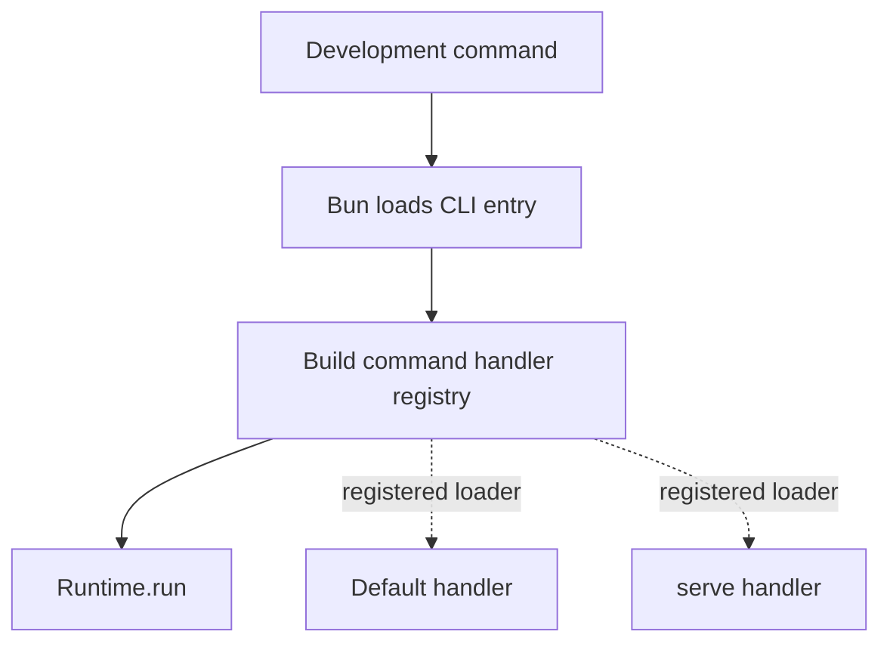

# CLI startup and application boundaries

## Learning objectives and prerequisites

Trace the development invocation through the application entry, distinguish language execution from command dispatch, and explain the difference between a package dependency and a client-server request. Review concepts 13–21. [Concept index](../04-engineering-concepts/README.md)

## Primary references and actual implementation

The CLI imports `Commands` and `Runtime`, prepares process state, builds a handler registry and gives the command definition and registry to the runtime. Its top-level Effect program uses `NodeRuntime.runMain`. [CLI entry](https://github.com/anomalyco/opencode/blob/6f0514052a3c859894ad01bb14cc14dda1e44b96/packages/cli/src/index.ts#L1-L50) · [Runtime call and reporting](https://github.com/anomalyco/opencode/blob/6f0514052a3c859894ad01bb14cc14dda1e44b96/packages/cli/src/index.ts#L105-L190)

**Actual OpenCode source excerpt.** The arrow creates a loader. Its body evaluates `import()` when the loader is called. The excerpt establishes registration and leaves the later invocation path open.

```ts
$: () => import("./commands/handlers/default"),
```

## Execution flow and data



*Verified OpenCode entry and registration. The diagram covers source-backed relationships in OpenCode 01.*

**Illustrative CodeScope example.** The parser passes typed arguments to the core operation. Format the returned domain result at the boundary and keep each format testable.

```python
def run_inspect(path: str) -> int:
    result = inspect_repository(path)  # Domain operation.
    print(format_summary(result))       # Presentation boundary.
    return 0                           # Process status.
```

A command error can arise before a handler loads, during module evaluation, or during the operation. Lazy handlers can reduce startup work while adding first-use latency. Record both effects independently. Client-server transport adds connection and serialization failures to those paths. A schema can validate a decoded message and a protocol can determine whether it is meaningful in the current session. Request authorization and state validation are separate checks. The OpenCode package manifests establish client and server dependencies. Actual configuration order, process launch and transport behavior still need source tracing. [CLI manifest](https://github.com/anomalyco/opencode/blob/6f0514052a3c859894ad01bb14cc14dda1e44b96/packages/cli/package.json#L28-L47) · [Server manifest](https://github.com/anomalyco/opencode/blob/6f0514052a3c859894ad01bb14cc14dda1e44b96/packages/server/package.json#L27-L37)

## Interview practice

- **Foundational** — What is an entry point? It is the first application code named by a particular invocation.
- **Applied** — When is the handler module loaded in the excerpt? When a caller invokes the registered loader and evaluates its dynamic import.
- **Advanced** — Why can schema validation succeed while the request fails? The shape may be valid while authorization or session state makes the operation invalid.

## Exercise, verification and mastery

Draw a path from an illustrative `inspect` invocation to a handler result. Show where invalid arguments and a failed module import appear, then explain where a future browser client adds a transport boundary. No upstream runtime tests were performed. Assess understanding by having the learner trace the source excerpt and defend each boundary.

## Revision summary

Follow invocation → entry point → dispatch → handler. Treat package graphs and observed runtime calls as different evidence.
